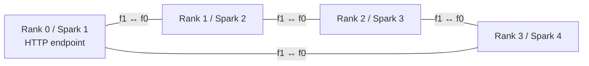

# GLM-5.3-Flash EXL3 on a four-DGX-Spark ring with TensorFold

Run the pinned Mia TensorFold image across four DGX Sparks connected directly
in a closed RoCE ring. The model uses all four ranks and both PCIe paths to each
neighbor. No switch, manual IP routes, OS forwarding changes, firewall rules,
or NIC hairpin configuration are required by this recipe.

The engine and transport were validated on a real four-Spark cluster. This
portable packaging replaces the original deployment's site-specific addresses
with a reviewed JSON configuration. Its configuration guards, command plans and
source checks are tested offline; a fresh installation must run its own hardware
qualification. No historical receipt in `results/` authorizes a new deployment.

## Topology and serving profile



Each physical port has two host-visible functions on separate PCIe roots. The
example configuration maps all four HCA functions per host, using separate /24
subnets for the two paths of each cable. Discover your actual interfaces and
cabling before editing it. Two physical ports share two PCIe Gen5 x4 host links;
four functions do not imply four independent PCIe uplinks.

The patched NCCL uses direct neighbor links and Ring collectives. TensorFold
uses `TF_GLM_COMM=nccl` and `TF_GLM_HC_EXCHANGE=gather`, avoiding the all-peer
exchange that requires direct connectivity to non-neighbors. The custom
SparkRing/SIRCL runtime is not loaded. Management Ethernet carries SSH and
bootstrap traffic. The patch's subnet-routing setting selects RoCE devices/GIDs
inside NCCL; it does not configure OS routing or forwarding.

| Setting | Default |
| --- | --- |
| Engine | Mia TensorFold v0.6.0 image with 96 patches, immutable digest |
| Tensor parallel ranks | 4 |
| Context per request, prompt plus reply | 1,048,576 tokens |
| Active decode lanes | 8 |
| Shared speculative verify window | 64 rows |
| Kept prompt states | 32 |
| Default reply allowance | 32,768 tokens |
| Extra KV memory beyond base context | 24 GiB per rank |
| Memory reserve | 20 GiB per rank |
| KV / dense kernels | FP8 latent KV / Q4 |
| Drafter | DFlash2 `fnc7:0.3`, copy drafts enabled |

The observed pool was **4,569,088 tokens**, shared by active and kept prompts
and replicated per rank. Eight full 1M contexts cannot all reside in that pool
at once. The configured 1M limit was validated with a 26,333-token prompt and
32,768-token reply allowance; RigMark additionally exercises 64K raw prompts.
A full 1M input and eight simultaneous full-window requests were not tested.
Eight lanes is the selected baseline profile, not a physical network limit.

## Prerequisites

- Four ARM64 DGX Sparks, working NVIDIA drivers/container GPU runtime, Docker,
  and a shared directory mounted at the same absolute path on every Spark.
- On each Spark: Python 3, NetworkManager/`nmcli`, `ip`, `rdma`, `ethtool`,
  `iptables-save`, `ip6tables-save`, `ss`, and working RoCE devices. The native
  builder also needs Git, GCC/G++, Make and a CUDA toolkit supporting SM121.
  The validated NCCL build used CUDA 13.0.88 and GCC 13.3.0. Helpers do not
  install packages.
- Operator Python 3.10+ and SSH. Configure trusted host keys and passwordless
  root shells via **`sudo -n -s`** for an explicit `USER@IP` on each host.
  No private keys or host trust files are shipped or automatically provisioned.
- At least 200 GB free local model storage per Spark, plus image/build/cache
  space. Model snapshots total about 178 GB. Keep downloads and JIT/HF caches
  on local storage; the shared directory holds recipe sources and the library.
- Dedicated fabric interfaces without existing IPv4 assignments for the fresh
  fabric setup. Existing fabric configurations require explicit adoption/review;
  the helper refuses to replace them. Stop GPU workloads before fabric changes
  and collective qualification.

The DFlash2 dependency is CC BY-NC-ND 4.0. Its upstream licence and any separate
commercial agreement apply independently of this recipe. See [credits and
licences](CREDITS.md); no weights or container layers are redistributed here.

## Set up a fresh cluster

Clone this repository into the shared directory, for example
`/shared/spark-ring-tensorfold`. All commands below run from that directory
unless marked as Spark-local. Keep real configuration and trust files under
ignored `local/`:

```bash
mkdir -p local
cp config.example.json local/config.json
```

Edit `shared_root`, all four explicit SSH destinations/management addresses,
management interfaces, and the fabric link/HCA mapping. The example management
addresses are documentation addresses. Either supply an already trusted
`ssh_options.known_hosts_file`, or remove that option to use your existing SSH
trust store. SSH uses strict host verification and never updates trust files.
Optionally supply an existing `identity_file`; keys are not copied by this recipe.

Review plans before changing hosts:

```bash
python3 scripts/fabric.py plan --config local/config.json
python3 scripts/cluster.py plan --config local/config.json
bash scripts/build-nccl.sh --plan
python3 scripts/download-models.py --config local/config.json --plan
```

Configure only the dedicated fabric ports, then verify preservation and links:

```bash
python3 scripts/fabric.py check --config local/config.json
python3 scripts/fabric.py apply --config local/config.json
python3 scripts/fabric.py verify --config local/config.json
```

The helper creates new MAC-bound NetworkManager profiles with static fabric
IPv4 and MTU9000, no gateway/DNS/manual routes, and never-default settings.
IPv6 is ignored by these fresh profiles and its original state is checked.
Original profiles/files, default routes, forwarding/rp_filter settings and
firewall rules are checked against root-only backups. Kernel connected/local
routes resulting from assigned IP addresses are expected.

On **each Spark**, enter `sudo -s`, pull the pinned image, and download snapshots
to local storage. Substitute the paths you configured; the block below uses
the example paths. This download container does not request a GPU:

```bash
RECIPE_ROOT=/shared/spark-ring-tensorfold
MODEL_ROOT=/var/tmp/spark-ring-models
IMAGE=$(python3 -c 'import json,sys; print(json.load(open(sys.argv[1]))["image"])' "$RECIPE_ROOT/provenance.json")
docker pull "$IMAGE"
mkdir -p "$MODEL_ROOT"
docker run --rm --network host \
  --mount "type=bind,src=$RECIPE_ROOT,dst=/recipe,readonly" \
  --mount "type=bind,src=$MODEL_ROOT,dst=/models" \
  -e HF_HOME=/models/.hf-cache -e HF_XET_HIGH_PERFORMANCE=1 \
  --entrypoint python "$IMAGE" /recipe/scripts/download-models.py \
  --config /recipe/local/config.json --output-root /models
```

Alternatively download once and copy the complete pinned snapshots and receipts
to the same local model directory on the other hosts. Preserve the full file set;
the launcher checks the model shard index and the immutable download receipts.
No model data is placed in this Git repository.

On **one Spark**, inside its root shell, build and publish the isolated library
into a new shared `lib/` directory:

```bash
bash /shared/spark-ring-tensorfold/scripts/build-nccl.sh \
  --publish /shared/spark-ring-tensorfold/lib
```

The builder verifies the pristine NCCL commit/tree, cumulative patch hash and
patched tree, runs CPU ABI/GID/PCI-root tests, and compiles ARM64 SM121 kernels.
It writes a dedicated `/var/tmp/spark-ring-nccl-rebuild-*` directory, build logs,
hashes and licences. It does not install a global library or overwrite `lib/`.
The original build hash is recorded for provenance; a new build needs fresh
qualification even if its source is identical.

With all GPUs idle, qualify the actual TensorFold collective interface on all
four hosts before model loading:

```bash
python3 scripts/qualify.py --config local/config.json --plan
python3 scripts/qualify.py run --config local/config.json
python3 scripts/cluster.py check --config local/config.json
python3 scripts/cluster.py start --config local/config.json
```

Qualification covers changing-data all-gathers for FP32/BF16/int32/int64,
in-place/out-of-place buffers and CUDA graph replay, plus substantial payload
on every configured HCA and zero new transport errors. The fresh receipt binds
the image, library hash, topology and transport environment. Start refuses a
missing or mismatched receipt. Workers start before rank0; HTTP readiness is
checked after all ranks load. A rebuild or transport change requires requalification.

## Use and operate

The head node serves `http://HEAD_IP:8888/v1`, model
`GLM-5.3-Flash-EXL3`. The terminal client uses only the Python standard library:

```bash
python3 scripts/chat.py --config local/config.json
python3 scripts/chat.py --url http://HEAD_IP:8888/v1 --prompt 'What is 17 times 19?'
python3 scripts/cluster.py status --config local/config.json
python3 scripts/cluster.py logs --config local/config.json
python3 scripts/cluster.py stop --config local/config.json
```

Chat supports `/reset`, `/quit`, streaming replies and `--thinking`. It writes
no history. Start exposes context, lane, memory and port overrides; review
`--help`. The public launcher uses a distinct ownership label and refuses to
stop containers owned by another recipe. The original validated deployment's
containers were not restarted or adopted during public packaging.

## Measurements

Full pinned **RigMark 1.0.0** run: five completed outputs per workload,
low-effort reasoning, 4096-token ceiling; all **15/15 gates passed**. Settings,
seed and nonce-producing comparison ID match Alex's September 12 receipt.

| Metric (median tok/s) | Alex, 4 Sparks | This recipe, 4 Sparks | Ratio |
| --- | ---: | ---: | ---: |
| Completed code decode | 71.3 | **111.7** | 1.57x |
| Completed prose decode | 31.2 | **62.9** | 2.02x |
| Structured JSON ceiling | 109.2 | **157.1** | 1.44x |
| 64K cold prefill | 1,964.7 | **1,816.4** | 0.92x |
| 64K cached replay | 36,074.9 | **983,832.0** | 27.27x |
| C1 short code aggregate end-to-end | 43.0 | **82.7** | 1.92x |
| C2 short code aggregate end-to-end | 72.5 | **118.9** | 1.64x |
| C4 short code aggregate end-to-end | 110.8 | **162.3** | 1.46x |

Code ranged from 106.8 to 115.1 tok/s; prose from 60.4 to 63.5 tok/s.
Cold 64K prefill is about 8% slower. Cached replay represents near-complete
prefix reuse. These compare whole recipes with different quantisation,
engines, schedulers and context settings. All 54 expected inference requests
were accounted for; every configured HCA carried payload with zero new
errors and ranks remained unchanged.

Publish the [unaltered receipt](results/rigmark-result.json), [reference receipt](results/alex-rigmark-result.json), [comparison](results/rigmark-comparison.json), [runtime proof](results/rigmark-runtime-proof.json) and [source proof](results/rigmark-source-proof.json) together. The raw receipt says Git identity unknown because of NFS ownership/trust; the executed wrapper independently verified the clean pinned source. No result fields were edited. Future runs apply the Git trust exception only to the child process.

Prior SparkDash measurements used thinking disabled and fixed 400-token outputs:

| Workload | Active requests / server lane limit | Aggregate decode tok/s |
| --- | --- | ---: |
| Prose | 1 / 8 | 88.7 (one probe) |
| Prose | 8 / 8 | 215.7 |
| Python code | 8 / 8 | 290.7 |
| Counting | 8 / 8 | 537.5 |

C8 values are three-wave medians. These workloads and metrics differ from
RigMark's completed outputs and aggregate end-to-end concurrency measurements.
See [benchmark method](docs/benchmark-method.md), [SparkDash summary](results/sparkdash-summary.json)
and [immutable provenance](provenance.json).

The physical fabric measured **196.08 Gb/s** one-way host-memory RDMA payload
per cable using both PCIe paths, one cable at a time. This does not establish
simultaneous whole-ring saturation. Actual inference carried data over all 16
HCA functions with zero new errors. An earlier continuous C8 prose window
averaged about 12.3–12.6 Gb/s per cable; generation does not continuously fill
the 200G links.

## Change records and rollback

See [system changes and rollback](docs/system-changes.md). New deployments
write exact fabric/qualification/launcher operations under ignored `state/`,
plus root-only network backups. Keep these operational files private. Only
maintained sources, example configuration, licences and reviewed public results
belong in Git.

```bash
PYTHONDONTWRITEBYTECODE=1 python3 -m unittest discover -s tests -v
python3 scripts/check-public.py
```

Source and public-data checks also run in GitHub Actions. The packaging checks
do not start GPUs, connect to hosts, install packages, or alter the live service.
